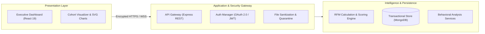
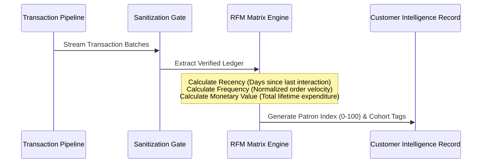

# The Patron Index

Customer Intelligence & Behavioral Analytics Platform

The Patron Index is an enterprise-grade customer intelligence platform designed to transform raw transaction records into behavioral cohorts, actionable RFM metrics, and normalized loyalty ratings. Built for high-volume customer analytics, the platform combines real-time data ingestion with automated cohort discovery, predictive retention scoring, and an interactive executive dashboard.

---

## Architecture Overview



---

## Enterprise Capabilities

| Capability | Architecture | Function |
| :--- | :--- | :--- |
| **RFM Cohort Engine** | Quantile-weighted recency, frequency, and monetary analytics | Automatically segments users into VIP, Loyal, Regular, New, Occasional, At-Risk, and Inactive cohorts |
| **Patron Index Scoring** | 0-100 normalized composite loyalty algorithm | Yields deterministic, explainable customer lifetime health metrics |
| **Streamlined Ingestion** | Streaming parser with memory-bounded validation and quarantine isolation | Sanitizes and processes multi-thousand transaction batches with schema validation |
| **Identity Federation** | Hybrid token verification supporting Google OAuth 2.0 and JWT | Provides secure session management with audit trail attribution |
| **Executive Visualizations** | Responsive SVG trendline animations, dynamic activity charts, and segment distribution tracking | Delivers real-time customer intelligence without client-side rendering bottlenecks |

---

## Scoring & Classification Methodology



### Cohort Definitions

- **VIP**: Top-percentile lifetime value and high purchase frequency within active engagement windows.
- **Loyal**: Sustained repeat purchasers exhibiting steady transaction intervals and high retention probability.
- **Regular**: Consistent baseline buyers representing stable, predictable revenue.
- **New**: First-time buyer records identified within the initial 30-day lifecycle window.
- **Occasional**: Sporadic purchase frequency requiring automated re-engagement triggers.
- **At-Risk**: High historical value with lapsed purchase recency exceeding 90 days.
- **Inactive**: Zero recorded purchasing activity beyond 180 days.

---

## Transaction Ingestion Schema

Bulk customer transaction logs can be ingested via the web workspace or automated via `POST /api/customers/import`.

| Column | Format | Validation | Description |
| :--- | :--- | :--- | :--- |
| `customer_id` | String / UUID | Required | Unique business identifier |
| `name` | String | Required | Full customer or entity name |
| `purchase_date` | ISO 8601 / YYYY-MM-DD | Required | Timestamp of settled transaction |
| `amount` | Decimal / Float | Required | Settled currency amount |
| `email` | RFC 5322 Email | Optional | Communication address |
| `product` | String | Optional | Purchased SKU, line item, or service description |

---

## API Reference

### Identity & Authentication

| Method | Endpoint | Access | Purpose |
| :--- | :--- | :--- | :--- |
| `POST` | `/api/auth/register` | Public | Account registration |
| `POST` | `/api/auth/login` | Public | Credential authentication with JWT issuance |
| `POST` | `/api/auth/google` | Public | Google Identity OAuth token verification |
| `GET` | `/api/health` | Public | Gateway uptime and cluster health check |

### Analytics & Customer Intelligence

All protected endpoints require authorization header: `Authorization: Bearer <JWT_TOKEN>`

| Method | Endpoint | Purpose |
| :--- | :--- | :--- |
| `GET` | `/api/dashboard/summary` | Retrieve aggregated portfolio metrics and revenue velocity |
| `GET` | `/api/customers` | Query segmented customer registry with pagination, search, and cohort filters |
| `GET` | `/api/customers/:id` | Fetch unified 360-degree customer profile and behavioral logs |
| `POST` | `/api/customers` | Programmatically insert or update a customer record |
| `POST` | `/api/customers/import` | Multi-part batch transaction ingestion and cohort recalculation |
| `POST` | `/api/scan/upload` | File quarantine and integrity analysis buffer |
| `GET` | `/api/scan/:id` | Query quarantine assessment status |

---

## Security & Compliance Architecture

- **Quarantine Pipeline**: Ingested files are buffered in isolated quarantine storage with randomized cryptographic identifiers prior to parsing.
- **Cryptographic Standards**: Authentication passwords utilize adaptive `bcrypt` hashing with individual salts.
- **Session Integrity**: Stateless JSON Web Tokens (JWT) verified against secret rotation policies.
- **Network Defense**: HTTP header hardening via `helmet` and strict cross-origin resource sharing (CORS) enforcement.
- **Input Neutralization**: High-throughput CSV streams execute strict column whitelisting to eliminate code execution and buffer overflow vectors.

---

## Deployment & Running

### Frontend Service

```bash
cd Frontend
npm install
npm run dev
```

### Backend API Service

```bash
cd backend
npm install
npm run dev
```

---

## License

Proprietary enterprise software. All rights reserved.
