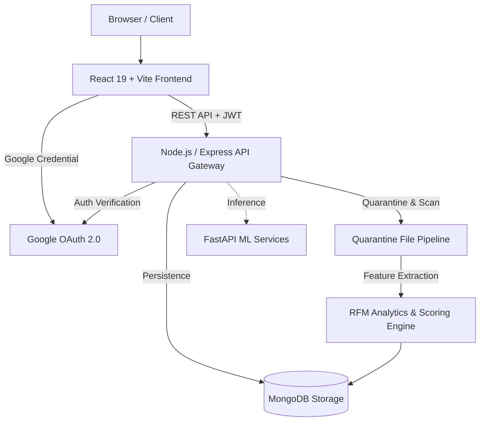
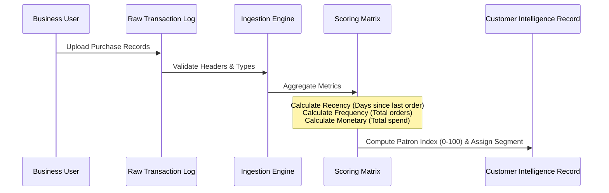

# The Patron Index

Customer Intelligence & Behavioral Segmentation Platform

The Patron Index converts raw transactional purchase records into actionable customer segments, recency-frequency-monetary (RFM) metrics, and proprietary Patron Index scores (0-100). The architecture couples a responsive React dashboard with an Express REST API, MongoDB document store, secure file quarantine pipeline, and optional machine learning services.

---

## System Architecture



---

## Core Capabilities

| Capability | Technical Implementation | Outcome |
| :--- | :--- | :--- |
| **RFM Segmentation** | Weighted quantile scoring on Recency, Frequency, and Monetary value | Classifies customers into VIP, Loyal, Regular, New, Occasional, At-Risk, and Inactive |
| **Patron Index Metric** | Normalized 0-100 composite index calculated per customer | Quantifies individual customer loyalty and lifetime value |
| **Data Ingestion** | CSV parsing with header validation and quarantine storage | Safe processing of customer purchase transactions |
| **Authentication** | Hybrid local JWT authentication and Google OAuth 2.0 token verification | Secure, auditable session management |
| **Visualization Suite** | SVG animated revenue curves, activity bar charts, segment progress tracks | Real-time analytics with collapsible sidebar and responsive layout |

---

## Repository Structure

```text
The-Patron-Index/
├── Frontend/                 React 19, Vite, React Router, Tailwind CSS
│   ├── src/
│   │   ├── components/       Layout, Header, Sidebar, RevenueChart, StatCard
│   │   ├── pages/            Landing, Dashboard, Customers, Segments, Analytics, Reports
│   │   ├── context/          AuthContext (Local & Google OAuth session management)
│   │   └── services/         API client and data normalization
├── backend/                  Express REST API, Mongoose, JWT, Multer
│   ├── controllers/          Auth, Customer, Dashboard, File Scan controllers
│   ├── middleware/           JWT verification, file quarantine, rate limiting
│   ├── models/               User, Customer, Transaction, Scan schemas
│   └── routes/               REST endpoint routing
├── ml/                       FastAPI classification and malware detection services
│   ├── business/             Business category classification service
│   └── malware/              File-risk and PE heuristic scanning engine
├── sample-data/              Validated sample dataset (customer_purchases.csv)
└── README.md
```

---

## Quick Start

<details open>
<summary><b>Option A: Frontend Demo Mode (Instant Evaluation)</b></summary>

The client includes an isolated demo mode providing pre-populated business metrics, charts, and customer segment profiles without requiring external database connections.

```bash
# Navigate to Frontend directory
cd Frontend

# Install dependencies
npm install

# Launch development server
npm run dev
```

Open `http://localhost:5173` in your browser and click **Open Demo Dashboard** or navigate directly to `/dashboard`.

</details>

<details open>
<summary><b>Option B: Full-Stack Setup (Production / Local Integration)</b></summary>

### 1. Prerequisites
- Node.js 18+ and npm
- MongoDB instance (local or MongoDB Atlas URI)
- Python 3.10+ (optional, for ML microservices)

### 2. Backend Configuration & Launch

```bash
cd backend
npm install
```

Create `backend/.env` with the following parameters:

```env
PORT=5000
NODE_ENV=development
MONGO_URI=mongodb://localhost:27017/patron-index
JWT_SECRET=replace_with_a_secure_random_secret_key
FRONTEND_URL=http://localhost:5173
GOOGLE_CLIENT_ID=978238561753-daj7ignsgo9lbg31ag5c0ke3lukuarbh.apps.googleusercontent.com
```

Start the backend:

```bash
npm run dev
```

Verify service status:
```text
GET http://localhost:5000/api/health
```

### 3. Frontend Configuration & Launch

```bash
cd Frontend
npm install
```

Create `Frontend/.env`:

```env
VITE_API_URL=http://localhost:5000/api
VITE_GOOGLE_CLIENT_ID=978238561753-daj7ignsgo9lbg31ag5c0ke3lukuarbh.apps.googleusercontent.com
```

Start the client:

```bash
npm run dev
```

</details>

<details>
<summary><b>Option C: Machine Learning Microservices (Optional)</b></summary>

```bash
cd ml
python -m venv venv
source venv/bin/activate  # Windows: .\venv\Scripts\activate
pip install -r requirements.txt

# Start Business Classification Service (Port 8001)
uvicorn ml.business.api.main:app --reload --port 8001

# Start File-Risk Inspection Service (Port 8002)
uvicorn ml.malware.api.main:app --reload --port 8002
```

</details>

---

## Data Ingestion Specification

Upload files via the dashboard import view (`/import`) or direct API invocation (`POST /api/customers/import`).

```text
Sample file location: sample-data/customer_purchases.csv
```

### CSV Schema Requirements

| Field | Type | Requirement | Description |
| :--- | :--- | :--- | :--- |
| `customer_id` | String | Required | Unique business identifier for customer |
| `name` | String | Required | Full customer name |
| `purchase_date` | ISO 8601 / YYYY-MM-DD | Required | Timestamp of transaction |
| `amount` | Number (Float) | Required | Monetary purchase value |
| `email` | String | Optional | Customer contact address |
| `product` | String | Optional | Product name or SKU |

---

## RFM & Scoring Methodology



### Customer Segments

- **VIP**: Top tier monetary spending and high transaction frequency within recent period.
- **Loyal**: Consistent repeat buyers with dependable purchase intervals.
- **Regular**: Average frequency and spending; core baseline patrons.
- **New**: First-time transactions recorded within the last 30 days.
- **Occasional**: Infrequent buyers requiring promotional re-engagement.
- **At-Risk**: Previously frequent buyers with recency exceeding 90 days.
- **Inactive**: No recorded purchasing activity for over 180 days.

---

## API Reference

### Authentication Endpoints

| Method | Route | Access | Description |
| :--- | :--- | :--- | :--- |
| `POST` | `/api/auth/register` | Public | Register business account with name, email, password |
| `POST` | `/api/auth/login` | Public | Authenticate with email/password and receive JWT |
| `POST` | `/api/auth/google` | Public | Verify Google OAuth credential and issue JWT |
| `GET` | `/api/health` | Public | System status and service health check |

### Authenticated Data Endpoints

Protected routes require standard authorization header: `Authorization: Bearer <JWT_TOKEN>`

| Method | Route | Description |
| :--- | :--- | :--- |
| `GET` | `/api/dashboard/summary` | Overall KPI metrics (customers, active count, revenue) |
| `GET` | `/api/customers` | Query customers with pagination, search, and segment filters |
| `GET` | `/api/customers/:id` | Detailed individual customer profile and history |
| `POST` | `/api/customers` | Create or update individual customer record |
| `POST` | `/api/customers/import` | Multipart CSV bulk upload and auto-segmentation |
| `POST` | `/api/scan/upload` | Upload file to secure quarantine buffer |
| `GET` | `/api/scan/:id` | Retrieve status of file safety assessment |

---

## Security Architecture

- **Quarantine Pipeline**: Uploaded files are isolated outside the public directory tree with random hash identifiers and MIME validation.
- **Credential Storage**: Passwords are salted and hashed using `bcrypt` prior to database persistence.
- **Token Security**: Stateless JWT verification with configurable token expiration and origin CORS verification.
- **Header Hardening**: HTTP security headers configured via `helmet`.
- **Input Sanitization**: CSV parsing implements column white-listing to prevent injection attacks and memory exhaustion.

---

## Verification & Testing

Execute frontend linting and production build verification:

```bash
# Frontend linting
npm --prefix Frontend run lint

# Production compilation
npm --prefix Frontend run build

# Backend tests / health check
npm --prefix backend test
```

---

## License

This project is licensed under the MIT License.
